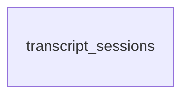

# ERD

마이그레이션(`backend/migrations/`)을 전부 적용한 스키마의 지도다. 판정은 [`README.md`](README.md) 「체커」가 한다.

### `transcript_sessions`

의미: [`Store`](../../backend/store.go)

| 컬럼 | 타입 | NULL | 키 |
|---|---|---|---|
| session_id | TEXT | YES | PK |
| s3_prefix | TEXT | NO | |
| created_at | TEXT | NO | |

| 인덱스 | 컬럼 | UNIQUE | 조건 |
|---|---|---|---|
